  

## `$ whoami`

  

## `$ cat tech-stack.yaml`

| `yona@fedora:~$ cat tech-stack.yaml` | |
| :--- | :--- |
| `├─ ✦ languages:`      `TypeScript · JavaScript · Python` | `├─ ◈ backend_web:`      `Node.js · HTML · CSS` |
| `├─ ◆ tools_infra:`      `Git · GitHub · Docker` | `╰─ ▣ linux_databases:`         `Fedora · KDE · Ubuntu · Debian · MySQL · PostgreSQL` |
| `status: learning  ·  environment: development` | |

## `$ ls projects/`

  

  
  

  

  
  

## `$ cat now.yml`

  

## `$ git log --stat`

  

<code>// always learning. always building.</code>

